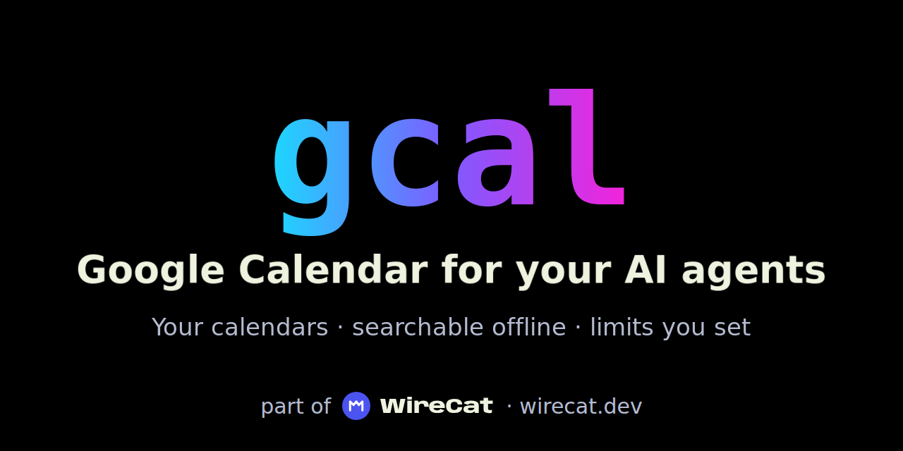

<p align="center">
  
</p>

# gcal: Google Calendar and Meet CLI for AI agents

<p align="center">
  Full control of your Google Calendar and Meet calls from the terminal. Every calendar of every Google account you
  use, read and write, for you and for Claude Code, Codex, Cursor or any AI agent.
</p>

<p align="center">
  <a href="https://wirecat.dev/en/docs/gcal">Docs</a> ·
  <a href="https://github.com/WireCatLabs/gcal-cli/blob/main/docs/usage.md">Examples</a> ·
  <a href="https://discord.gg/DebENqbRrJ">Discord</a>
</p>

<p align="center">
  <a href="https://www.npmjs.com/package/@wirecat/gcal-cli"></a>
  <a href="https://github.com/WireCatLabs/gcal-cli/actions/workflows/main.yml"></a>
  <a href="https://www.npmjs.com/package/@wirecat/gcal-cli"></a>
  <a href="https://github.com/WireCatLabs/gcal-cli/blob/main/LICENSE"></a>
</p>

- **Full control.** Sign in to each Google account you use, personal or work. Read every calendar, create, move and
  cancel events, answer invitations, add a Meet link, and reach every Google Calendar API method.
- **Deep search.** Your events are searched on your computer, with no network. Search matches words, and by meaning
  once you download a small model, so other words for the same thing are found too. Google's own search reaches
  events outside the synced span.
- **Meet calls you can come back to.** Who joined, the transcript and the Drive files Google made, linked to the
  calendar event and kept after Google deletes them.

## What you get

- **Know your week at a glance.** "What is on this week?" across every Google account you use, with clashes found.
- **Find a time for everyone.** Ask when people are free and get the stretches that suit all of them.
- **Book without the clicking.** Create, move and cancel events, with a Meet link when you want one. Nobody gets an
  email unless you allow it.
- **Remember what was said.** Past Meet calls with who joined and the transcript, ready to search and summarise.
- **Walk into a meeting prepared.** One command gathers the event, its attendees, your latest messages with them and
  your past meetings with them.
- **Find any event.** "When did we plan the roadmap review?" by words or by meaning, with no network.
- **See the whole picture.** Link a person's email to their Telegram or MAX account, and one search covers
  your events, chats, notes and meeting transcripts.

```text
You:    When can I meet Ana for 30 minutes this week?
Agent:  (runs gcal personal calendars busy person:ana@example.com --duration-minutes 30)
        You are both free on Tuesday 10:00-10:30, Wednesday 14:00-15:00 and Thursday 10:00-12:00.
You:    Book Tuesday, 30 minutes, "Example planning", with a Meet link. Do not email her.
Agent:  Draft: "Example planning", Tuesday 10:00-10:30, with ana@example.com, a new Meet link, no email sent.
        Create it?
You:    Yes.
```

*Invented people and events, illustrative output.*

## Why gcal

- **Your data never leaves your computer.** `gcal` talks only to Google. There is no WireCat server and no account
  with us. Your events are kept in a local database, and a meeting's passcode or PIN is never stored or printed.
- **Read-only until you say so.** The first sign-in reads only. Writing events, sharing calendars and Meet each need
  their own grant, and a delete asks first.
- **Search that goes all the way back.** A first sync copies a year back and three months ahead, and each later sync
  asks Google only for what changed. Search reads that copy by words or by meaning, or asks Google's own search.
- **Safe to give to an agent.** You decide what an agent may do, per command: allow, ask, read only or deny. A write
  never overwrites a change made in Google since the last sync. Text from an invitation is marked as untrusted, so an
  agent never takes it as an instruction.
- **Ready for any agent.** A skill for agents with a terminal, an MCP server for Claude Desktop and Cursor, and a
  secure link for ChatGPT and Claude in the browser or on your phone.
- **Free and open source.** Apache 2.0, on macOS, Linux and Windows.

How it compares with other calendar tools: [the comparison](https://wirecat.dev/en/docs/gcal/compare).

## Quick start

```sh
npm install -g @wirecat/gcal-cli
gcal skill install                  # the agent skill, for Claude Code, Codex and Gemini CLI
gcal personal session start         # sign in to Google in the browser, read-only
gcal personal sync                  # copy your calendars, then only what changed
gcal personal events list           # your events from today on, earliest first
```

It takes a few minutes. `personal` is a name you choose for this Google account. You can add `work` or any other
later. Every `gcal` package carries WireCat's own Google app, so you need no Google Cloud project. Google may refuse
the sign-in with it. Then [make your own Google app](https://wirecat.dev/en/docs/gcal/installation) and add
`--client-file ~/client_secret.json` to `session start`.

You need Node.js 22.16+ or 24+, or Bun. Try it without installing: `npx @wirecat/gcal-cli --help`.

More: [installation](https://wirecat.dev/en/docs/gcal/installation)

## Use it with your agent

Ask in plain words. The agent picks the commands.

> *"Use gcal. What is on my calendar this week, and what clashes?"*
> *"Use gcal. Prepare me for my next meeting."*
> *"Use gcal. What did we decide on the last call with Ana?"*

- **Claude Code, Codex, Gemini CLI** and other agents with a terminal run `gcal` themselves. `gcal skill install`
  teaches them how.
- **Claude Desktop, Cursor** and other MCP apps connect to `gcal personal mcp serve`.
- **ChatGPT or Claude in the browser or on your phone** reach it through your own HTTPS tunnel.

```sh
gcal personal mcp add claude-code --allow-writes   # or: codex
gcal personal mcp config                           # the entry for Claude Desktop, Cursor and others
```

More: [agents](https://wirecat.dev/en/docs/gcal/usage) · [from the browser](https://wirecat.dev/en/docs/gcal/remote)

## What it can do

### Your calendars

```sh
gcal personal events list --source all                    # every account's events in one list
gcal personal events list overlapping:true --source all   # meetings that clash, across accounts
gcal personal events list changed_at>=2026-10-25          # what is new, moved or cancelled since a date
gcal personal events show event:42                        # attendees, Drive files and history
gcal personal events prepare                              # what the store holds for your next meeting
```

Only the calendars you own sync at first. `gcal personal calendars list` shows the rest, and
`gcal personal calendars sync 3` adds calendar 3. Holiday calendars and other `.ics` feeds can be followed too.

### Find a time and book it

```sh
gcal personal calendars busy person:ana@example.com --duration-minutes 30 --hours 10:00-16:00
gcal personal session start --grant write                 # sign in again to change events
gcal personal events create 3 --title "Sync" --start-time 2026-11-20T10:00 --end-time 2026-11-20T10:30 \
  --conference google-meet
gcal personal events respond event:42 accepted --notify
```

`calendars busy` shows a person's busy times only when their calendar is shared with you or your organisation. A
delete asks first, and Google mails other attendees only when you allow it.

### Search

```sh
gcal personal search events roadmap planning                    # the local copy, best match first
gcal personal search events --backend server quarterly review   # Google's own search
gcal personal search all roadmap                                # events, messages and notes of every WireCat tool
gcal models download e5-small                                   # once, for search by meaning
```

### Google Meet

```sh
gcal personal session start --grant meetings   # read access to your Meet calls
gcal personal meetings sync                    # keep the calls of the last 30 days
gcal personal meetings show 12                 # one call: who joined, its transcript and Drive files
gcal personal meetings transcript 12           # what was said, line by line
gcal personal meetings create --setting access_type=trusted   # a new Meet room, after --grant write,meetings
```

Google lists only the calls you organised. A call you joined opens by its id with `meetings show`. Google deletes a
call's record 30 days after it ends, so sync at least every few weeks. Personal Google accounts get no transcripts.
`gcal` keeps the Drive files by their id and never downloads them. drive-cli reads them.

More: [use it](https://wirecat.dev/en/docs/gcal/usage) · [all commands](https://wirecat.dev/en/docs/gcal/commands)

### With your other sources

`gcal` keeps what it reads in the same local database as the other WireCat tools, such as Telegram, WhatsApp and MAX.
`gcal personal search all` finds a word in events, messages and notes at once, and in meeting transcripts when
`--source` names a meeting account. Mail has its own search in memo. `gcal personal people link email:ana@example.com telegram:12345` records that two accounts are one
person.

More: [WireCat](https://wirecat.dev)

## How it works

- **Your own sign-in.** `gcal` signs in to Google through OAuth, and the sign-in is kept in your system keyring.
  Where the keyring does not work, it uses a file only you can read and says so once.
- **A local copy.** `sync` saves every page as it goes. A big first sync stops before its time limit and says
  `partial`, and the next `sync` goes on from there. Repeating events are stored one by one, cancelled ones included.
- **Polite to Google.** A Meet rate limit stops the sync, keeps what it saved and says when to run it again.
- **Safe writes.** `--dry-run` shows the permission a write needs and does nothing. `--read-only` refuses every
  write for one run.
- **Made for scripts.** `--json` gives one JSON value for every command, and an error comes as JSON with a code to
  branch on.

More: [settings and permissions](https://wirecat.dev/en/docs/gcal/configuration)

## Settings and permissions

Each account (profile) has its own permissions: `allow`, `ask`, `readonly` or `deny`, for one command or a group.

```sh
gcal personal config set permissions.api readonly            # reads only, every method
gcal personal config set permissions.events.create ask       # ask before each new event
```

By default deleting an event asks, and mailing other attendees is denied.

More: [settings and permissions](https://wirecat.dev/en/docs/gcal/configuration)

## Security

No command, error, log or run record shows a token or the client secret. A meeting's passcode or PIN is never
stored, and a join link is kept without its query string. Meet participant names and transcripts are marked as
untrusted for an agent. An agent connected over MCP can share a calendar without asking you, so
`gcal personal config set permissions.api.calendar.acl deny` stops that.

More: [security](https://wirecat.dev/en/docs/gcal/security) · Report a vulnerability:
[SECURITY.md](https://github.com/WireCatLabs/gcal-cli/blob/main/SECURITY.md)

## When something goes wrong

```sh
gcal doctor                              # what is set up, no network
gcal personal session status --check     # does Google still accept the sign-in
gcal personal runs list                  # failed runs are kept
```

More: [troubleshooting](https://wirecat.dev/en/docs/gcal/troubleshooting) · Ask on
[Discord](https://discord.gg/DebENqbRrJ) · Bugs go to this repository's issues.

## Documentation

Everything is on [wirecat.dev/en/docs/gcal](https://wirecat.dev/en/docs/gcal). The same pages are in
[docs/](https://github.com/WireCatLabs/gcal-cli/blob/main/docs/index.md).

## Development

```sh
pnpm install && pnpm test
```

More: [design](https://github.com/WireCatLabs/gcal-cli/blob/main/docs/dev/DESIGN.md) ·
[testing](https://github.com/WireCatLabs/gcal-cli/blob/main/docs/dev/TESTING.md)

Pull requests, bug reports and ideas go to [issues](https://github.com/WireCatLabs/gcal-cli/issues).

## Part of WireCat

`gcal` is one of the [WireCat](https://wirecat.dev) tools: open-source, local-first command-line tools that give AI
agents your context from messengers, mail, calendars and documents. Each one works on its own.

## License

[Apache 2.0](https://github.com/WireCatLabs/gcal-cli/blob/main/LICENSE)
